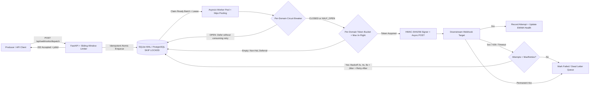
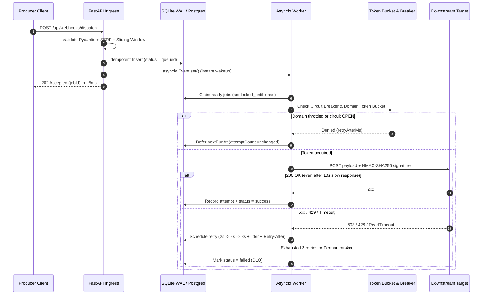

# PulseHook — Distributed Webhook Dispatcher Engine (Python + FastAPI)

**Live Deployment:** https://pulsehook-webhook-dispatcher.onrender.com  
**Interactive Mission Control UI:** https://pulsehook-webhook-dispatcher.onrender.com/  
**Swagger API Docs:** https://pulsehook-webhook-dispatcher.onrender.com/docs  
**Health Check:** https://pulsehook-webhook-dispatcher.onrender.com/health  

**PulseHook** is a production-grade, non-blocking Distributed Webhook Dispatcher built with **Python 3.12, FastAPI, `asyncio`, and `httpx`**. It ingests webhook events in single-digit milliseconds (`202 Accepted`), persists jobs durably, protects downstream servers with **per-domain Token Bucket rate limiting (without Head-of-Line blocking)** and **per-domain Circuit Breakers**, retries transient failures (`5xx`, `429`, timeouts) with **exponential backoff + jitter**, signs payloads with **HMAC-SHA256**, tracks **EWMA latency & health diagnostics**, and ships with a live Mission Control dashboard and built-in Chaos Mock Receiver.

---

## System Architecture Flowchart



---

## Request & Retry Lifecycle (Sequence Diagram)



---

## Deep-Dive Architectural Choices & Trade-Offs

### 1. Non-Blocking Ingestion (`202 Accepted`) & Background Execution
- `POST /api/webhooks/dispatch` validates the JSON schema (Pydantic v2), enforces SSRF rules, checks the ingress Sliding-Window rate limiter, persists one indexed job row, triggers `worker.nudge()` via `asyncio.Event`, and immediately returns **`202 Accepted`**.
- **Why not `asyncio.create_task()` directly inside the HTTP route?** Fire-and-forget tasks vanish if the server restarts, provide no concurrency cap, and cannot coordinate per-domain rate limits across requests. Decoupling ingestion from execution through a durable queue guarantees zero dropped webhooks and bounded worker concurrency (`WORKER_CONCURRENCY=16`) using pooled `httpx.AsyncClient` connections.

### 2. State Persistence, Idempotency & Crash Recovery
- **Dual-Mode Storage (`JobRepository` abstraction):**
  - **Embedded SQLite in WAL mode (default):** Uses `aiosqlite` with `PRAGMA journal_mode = WAL`, `synchronous = NORMAL`, and `BEGIN IMMEDIATE` transactions for sub-millisecond writes without requiring external paid databases on free-tier hosts.
  - **PostgreSQL Horizontal Scale Mode (`DATABASE_URL` set):** Automatically switches to `asyncpg` using `SELECT ... FOR UPDATE SKIP LOCKED` so multiple stateless worker containers can claim jobs concurrently without lock contention or duplicate delivery.
- **Idempotency:** Deduplicates repeated dispatches using `Idempotency-Key` or `(eventId, destinationUrl)` inside the DB transaction so upstream retries never cause duplicate deliveries.
- **Stale-Lease Recovery:** Claimed jobs receive a `locked_until` lease timestamp. If a worker crashes mid-delivery, the background reaper reclaims expired leases back to `queued`/`retrying` on startup and periodically.

### 3. Rate Limiting Without Head-of-Line (HoL) Blocking
- **Per-Domain Egress Token Bucket + In-Flight Cap:** Each destination domain (`hostname:port`) has an independent Token Bucket (`capacity=5`, `refill_per_sec=2`) and `max_inflight=3` cap.
- **Why defer instead of `await asyncio.sleep()`?** Sleeping inside a worker when Domain A hits a rate limit stalls that worker slot for Domain B (**Head-of-Line blocking**). Instead, PulseHook releases the job lease, updates `next_run_at` to the exact refill timestamp **without incrementing `attemptCount`**, and immediately dispatches healthy domains.
- **Ingress & Mock Sliding-Window Log Limiter:** Protects `POST /api/webhooks/dispatch` and `POST /api/mock/receiver` against burst floods using an exact sliding-window timestamp log, returning `429 Too Many Requests` with `X-RateLimit-Limit`, `X-RateLimit-Remaining`, `X-RateLimit-Reset`, and `Retry-After` headers.

### 4. Error Handling, Retry Math & Circuit Breaker
- **Smart Failure Classification:**
  - **Transient errors (`5xx`, `429`, `408`, network/timeout errors):** Retried up to **3 times** (4 total attempts) using exponential backoff (`2s -> 4s -> 8s` via `RETRY_BASE_DELAY_MS * 2^(attempt-1)`) plus **`±15%` bounded jitter** to prevent thundering herds. Honors downstream `Retry-After` headers when present.
  - **Permanent client errors (`400`, `401`, `403`, `404`, `422`):** Fail fast into the Dead Letter Queue (`failed`) instead of wasting 3 retries on an invalid endpoint or payload. Failed jobs can be inspected and manually replayed via `POST /api/webhooks/jobs/{job_id}/replay`.
- **Per-Domain Circuit Breaker (`CLOSED -> OPEN -> HALF_OPEN`):** Trips `OPEN` after consecutive `5xx`/timeout failures to shed load and protect workers during outages, then probes recovery via `HALF_OPEN`. Notably, `429` responses **do not** trip the outage circuit breaker because `429` indicates the target is healthy and simply asking the dispatcher to pace deliveries.

### 5. Security & Observability
- **HMAC-SHA256 Signatures:** Every delivery includes `X-Webhook-Timestamp` and `X-Webhook-Signature: t=<ts>,v1=<hmac>` so receivers can verify authenticity and prevent replay attacks.
- **SSRF Protection:** Blocks non-HTTP(S) schemes, cloud metadata endpoints (`169.254.169.254`), and private/loopback IPs when `ALLOW_PRIVATE_URLS=false`.
- **EWMA Health Diagnostics:** Tracks rolling EWMA latency and online Z-score spikes per domain with zero latency impact on the dispatch path.

---

## Quick Start (Local Development)

**Prerequisites:** Python `>= 3.11`

```bash
python -m venv .venv
# Windows PowerShell:
.\.venv\Scripts\Activate.ps1
# macOS/Linux: source .venv/bin/activate

pip install -r requirements.txt
uvicorn app.main:app --host 0.0.0.0 --port 3000 --reload --reload-dir app
```

- **Live Mission Control Dashboard:** `http://localhost:3000`
- **Interactive Swagger API Docs:** `http://localhost:3000/docs`

Run the automated unit, integration, and stress test suite (15 tests):

```bash
pytest -v
```

---

## API Reference & `curl` Testing Commands

> Examples below point to the live deployment. Replace with `http://localhost:3000` for local testing.

### 1. Dispatch a Webhook (`POST /api/webhooks/dispatch`)

```bash
curl -X POST https://pulsehook-webhook-dispatcher.onrender.com/api/webhooks/dispatch \
  -H "Content-Type: application/json" \
  -d '{
    "destinationUrl": "https://pulsehook-webhook-dispatcher.onrender.com/api/mock/receiver?mode=ok",
    "eventId": "evt_123456",
    "payload": {
      "event": "user.signup",
      "userId": "usr_999"
    }
  }'
```

**Expected Response (`202 Accepted`):**
```json
{
  "status": "queued",
  "jobId": "job_a1b2c3d4e5f60718",
  "eventId": "evt_123456",
  "deduplicated": false,
  "currentJobStatus": "queued"
}
```

### 2. Verify Non-Blocking Behavior (10-Second Slow Downstream)

```bash
curl -w "\nHTTP %{http_code} in %{time_total}s\n" \
  -X POST https://pulsehook-webhook-dispatcher.onrender.com/api/webhooks/dispatch \
  -H "Content-Type: application/json" \
  -d '{
    "destinationUrl": "https://pulsehook-webhook-dispatcher.onrender.com/api/mock/receiver?mode=slow&delayMs=10000",
    "eventId": "evt_slow_10s",
    "payload": { "event": "report.ready", "userId": "usr_999" }
  }'
```

### 3. Test Exponential Backoff Retries (Flaky Target)

```bash
curl -X POST https://pulsehook-webhook-dispatcher.onrender.com/api/webhooks/dispatch \
  -H "Content-Type: application/json" \
  -d '{
    "destinationUrl": "https://pulsehook-webhook-dispatcher.onrender.com/api/mock/receiver?mode=flaky&failCount=2",
    "eventId": "evt_flaky_01",
    "payload": { "event": "order.paid" }
  }'
```

### 4. Rapid-Fire Burst Test (Rate Limiting Verification)

```bash
for i in $(seq 1 15); do
  curl -s -o /dev/null -w "Req $i -> %{http_code} (%{time_total}s)\n" \
    -X POST https://pulsehook-webhook-dispatcher.onrender.com/api/webhooks/dispatch \
    -H "Content-Type: application/json" \
    -d "{\"destinationUrl\":\"https://pulsehook-webhook-dispatcher.onrender.com/api/mock/receiver?mode=ok\",\"eventId\":\"evt_burst_$i\",\"payload\":{\"seq\":$i}}" &
done
wait
```

### 5. Inspect Job Status, Replay DLQ, & View Metrics

```bash
curl https://pulsehook-webhook-dispatcher.onrender.com/api/webhooks/jobs/<jobId>
curl -X POST https://pulsehook-webhook-dispatcher.onrender.com/api/webhooks/jobs/<jobId>/replay
curl https://pulsehook-webhook-dispatcher.onrender.com/api/metrics
```

A ready-to-import **`postman_collection.json`** (pre-configured with the live deployment URL) is included in the repository root.

---

## Project Structure

```text
app/
  main.py                    # FastAPI app + lifespan startup/shutdown
  config.py                  # Pydantic environment settings
  models.py                  # Request, response, and domain schemas
  routes/
    webhooks.py              # /api/webhooks/dispatch, /jobs, /replay
    mock.py                  # Built-in chaos mock receiver + sliding window
    system.py                # /health and /api/metrics
  worker/
    dispatcher.py            # Asyncio worker pool, retries, backoff + jitter
  storage/
    repository.py            # JobRepository interface
    sqlite_repo.py           # Async SQLite WAL persistence + lease recovery
    postgres_repo.py         # Async PostgreSQL FOR UPDATE SKIP LOCKED
  rate_limit/
    token_bucket.py          # Non-HoL per-domain Token Bucket + concurrency cap
    sliding_window.py        # Sliding-Window Log rate limiter
  resilience/
    circuit_breaker.py       # Per-domain CLOSED/OPEN/HALF_OPEN breaker
    anomaly.py               # EWMA latency & health diagnostics
  security/
    signer.py                # HMAC-SHA256 signing & SSRF URL guard
  ui/
    dashboard.html           # Live Mission Control web dashboard
tests/                       # Unit, integration, and 50-burst stress tests
```

---

## Deployment (Free Tier Ready)

Includes `Dockerfile`, `render.yaml`, and `fly.toml`.

### Option A: Render (Recommended Free Tier)
1. Push this repository to GitHub.
2. In Render Dashboard, choose **New + -> Blueprint** (auto-detects `render.yaml`) or **Web Service -> Docker**.
3. Verify `GET https://pulsehook-webhook-dispatcher.onrender.com/health` returns `200 OK`.

### Option B: Railway / Fly.io
- **Railway:** Connect GitHub repo -> automatically detects `Dockerfile` -> generate public domain.
- **Fly.io:** `fly launch --copy-config && fly deploy`.
