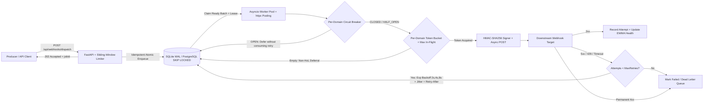

# PulseHook — Distributed Webhook Dispatcher Engine (Python + FastAPI)

**PulseHook** is a production-grade, non-blocking Distributed Webhook Dispatcher built with **Python 3.12, FastAPI, `asyncio`, and `httpx`**. It ingests webhook events in single-digit milliseconds (`202 Accepted`), persists jobs durably, protects downstream servers with **per-domain Token Bucket rate limiting (without Head-of-Line blocking)** and **per-domain Circuit Breakers**, retries transient failures (`5xx`, `429`, timeouts) with **exponential backoff + jitter**, signs payloads with **HMAC-SHA256**, tracks **EWMA latency & health diagnostics**, and provides a live Mission Control dashboard + Swagger API docs.

---

## Architecture Overview



---

## Key Architectural Choices & Interview Highlights

1. **Non-Blocking Ingestion (`202 Accepted`) + `asyncio.Event` Worker Wakeup**
   - `POST /api/webhooks/dispatch` validates via Pydantic v2 + SSRF checks, enqueues atomically, signals `worker.nudge()` via `asyncio.Event`, and immediately returns `202 Accepted`.
   - Even if a downstream endpoint takes **10+ seconds** or receives rapid-fire bursts, the ASGI request handler never awaits outbound HTTP calls.

2. **Dual-Mode Durable Persistence (SQLite WAL Default + PostgreSQL `FOR UPDATE SKIP LOCKED`)**
   - **Zero-config free-tier mode (default):** Uses `aiosqlite` in **WAL mode** (`PRAGMA journal_mode = WAL; synchronous = NORMAL;`) with `BEGIN IMMEDIATE` transactions for crash-safe persistence without external paid databases.
   - **Horizontal scaling mode (`DATABASE_URL` set):** Automatically switches to **`asyncpg` + PostgreSQL** using `FOR UPDATE SKIP LOCKED` so multiple stateless worker pods claim jobs concurrently without lock contention or duplicate deliveries.
   - **Crash-Safe Lease Recovery:** Claimed jobs hold a `locked_until` lease timestamp; a background reaper reclaims expired leases on startup and periodically so no job is ever stranded after a crash.

3. **Non-Head-of-Line-Blocking Per-Domain Token Bucket + Concurrency Guard**
   - Calling `await asyncio.sleep()` inside a worker when Domain A hits a rate limit stalls the worker for Domain B (**Head-of-Line blocking**).
   - PulseHook isolates every destination domain (`hostname:port`) with its own **Token Bucket** (`capacity`, `refill_per_sec`) and `max_inflight` cap. When Domain A is throttled, the worker releases the lease, defers `next_run_at` to the exact refill timestamp *without burning a retry attempt*, and immediately serves Domain B.

4. **Dual-Layer Rate Limiting (Egress Token Bucket + Ingress/Mock Sliding Window)**
   - **Outbound (Egress):** Per-domain Token Bucket ensures no single destination domain is flooded during traffic spikes.
   - **Inbound (Ingress & Built-in Mock Receiver):** Exact **Sliding-Window Log** limiter returns `429 Too Many Requests` with `X-RateLimit-*` and `Retry-After` headers.

5. **Resilient Retries + Per-Domain Circuit Breaker + EWMA Diagnostics**
   - Retries `5xx`, `429`, `408`, and network timeouts up to **3 times** (4 total attempts) with exponential backoff (`2s -> 4s -> 8s` + `±15%` jitter) and `Retry-After` header support.
   - Permanent `4xx` (`400`, `404`, `422`) fail fast to the Dead Letter Queue (`failed`) and can be replayed via `POST /api/webhooks/jobs/{job_id}/replay`.
   - Tracks rolling **EWMA latency & Z-score anomaly detection** per domain without adding latency to the dispatch path.

---

## Quick Start (Local Development)

**Prerequisites:** Python `>= 3.11`

```bash
python -m venv .venv
# Windows PowerShell:
.\.venv\Scripts\Activate.ps1
# macOS/Linux: source .venv/bin/activate

pip install -r requirements.txt
uvicorn app.main:app --host 0.0.0.0 --port 3000 --reload --reload-dir app
```

- **Live Mission Control Dashboard:** `http://localhost:3000`
- **Interactive Swagger API Docs:** `http://localhost:3000/docs`

Run the automated test suite:

```bash
pytest -v
```

---

## API Reference & `curl` Testing Commands

> Replace `http://localhost:3000` with your live deployed URL (e.g., `https://your-app.onrender.com`).

### 1. Dispatch a Webhook (`POST /api/webhooks/dispatch`)

```bash
curl -X POST http://localhost:3000/api/webhooks/dispatch \
  -H "Content-Type: application/json" \
  -d '{
    "destinationUrl": "http://localhost:3000/api/mock/receiver?mode=ok",
    "eventId": "evt_123456",
    "payload": {
      "event": "user.signup",
      "userId": "usr_999"
    }
  }'
```

**Expected Response (`202 Accepted`):**
```json
{
  "status": "queued",
  "jobId": "job_a1b2c3d4e5f60718",
  "eventId": "evt_123456",
  "deduplicated": false,
  "currentJobStatus": "queued"
}
```

### 2. Verify Non-Blocking Behavior (10-Second Slow Downstream)

```bash
curl -w "\nHTTP %{http_code} in %{time_total}s\n" \
  -X POST http://localhost:3000/api/webhooks/dispatch \
  -H "Content-Type: application/json" \
  -d '{
    "destinationUrl": "http://localhost:3000/api/mock/receiver?mode=slow&delayMs=10000",
    "eventId": "evt_slow_10s",
    "payload": { "event": "report.ready", "userId": "usr_999" }
  }'
```

### 3. Test Exponential Backoff Retries (Flaky Target)

```bash
curl -X POST http://localhost:3000/api/webhooks/dispatch \
  -H "Content-Type: application/json" \
  -d '{
    "destinationUrl": "http://localhost:3000/api/mock/receiver?mode=flaky&failCount=2",
    "eventId": "evt_flaky_01",
    "payload": { "event": "order.paid" }
  }'
```

### 4. Rapid-Fire Burst Test (Rate Limiting Verification)

```bash
for i in $(seq 1 15); do
  curl -s -o /dev/null -w "Req $i -> %{http_code} (%{time_total}s)\n" \
    -X POST http://localhost:3000/api/webhooks/dispatch \
    -H "Content-Type: application/json" \
    -d "{\"destinationUrl\":\"http://localhost:3000/api/mock/receiver?mode=ok\",\"eventId\":\"evt_burst_$i\",\"payload\":{\"seq\":$i}}" &
done
wait
```

### 5. Inspect Job Status, Replay DLQ, & View Metrics

```bash
curl http://localhost:3000/api/webhooks/jobs/<jobId>
curl -X POST http://localhost:3000/api/webhooks/jobs/<jobId>/replay
curl http://localhost:3000/api/metrics
```

A ready-to-import **`postman_collection.json`** is included in the repository root.

---

## Project Structure

```text
app/
  main.py                    # FastAPI app + lifespan startup/shutdown
  config.py                  # Pydantic environment settings
  models.py                  # Request, response, and domain schemas
  routes/
    webhooks.py              # /api/webhooks/dispatch, /jobs, /replay
    mock.py                  # Built-in chaos mock receiver + sliding window
    system.py                # /health and /api/metrics
  worker/
    dispatcher.py            # Asyncio worker pool, retries, backoff + jitter
  storage/
    repository.py            # JobRepository interface
    sqlite_repo.py           # Async SQLite WAL persistence + lease recovery
    postgres_repo.py         # Async PostgreSQL FOR UPDATE SKIP LOCKED
  rate_limit/
    token_bucket.py          # Non-HoL per-domain Token Bucket + concurrency cap
    sliding_window.py        # Sliding-Window Log rate limiter
  resilience/
    circuit_breaker.py       # Per-domain CLOSED/OPEN/HALF_OPEN breaker
    anomaly.py               # EWMA latency & health diagnostics
  security/
    signer.py                # HMAC-SHA256 signing & SSRF URL guard
  ui/
    dashboard.html           # Live Mission Control web dashboard
tests/                       # Unit, integration, and 50-burst stress tests
```

---

## Deployment (Free Tier Ready)

Includes `Dockerfile`, `render.yaml`, and `fly.toml`.

### Option A: Render (Recommended Free Tier)
1. Push this repository to GitHub.
2. In Render Dashboard, choose **New + -> Blueprint** (auto-detects `render.yaml`) or **Web Service -> Docker**.
3. Verify `GET https://<your-service>.onrender.com/health` returns `200 OK`.

### Option B: Railway / Fly.io
- **Railway:** Connect GitHub repo -> automatically detects `Dockerfile` -> generate public domain.
- **Fly.io:** `fly launch --copy-config && fly deploy`.
